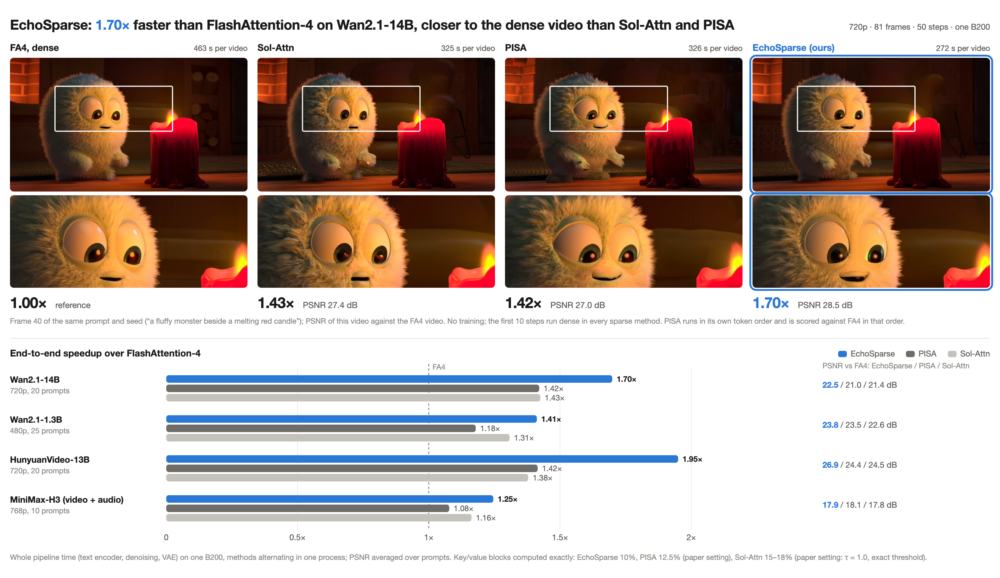
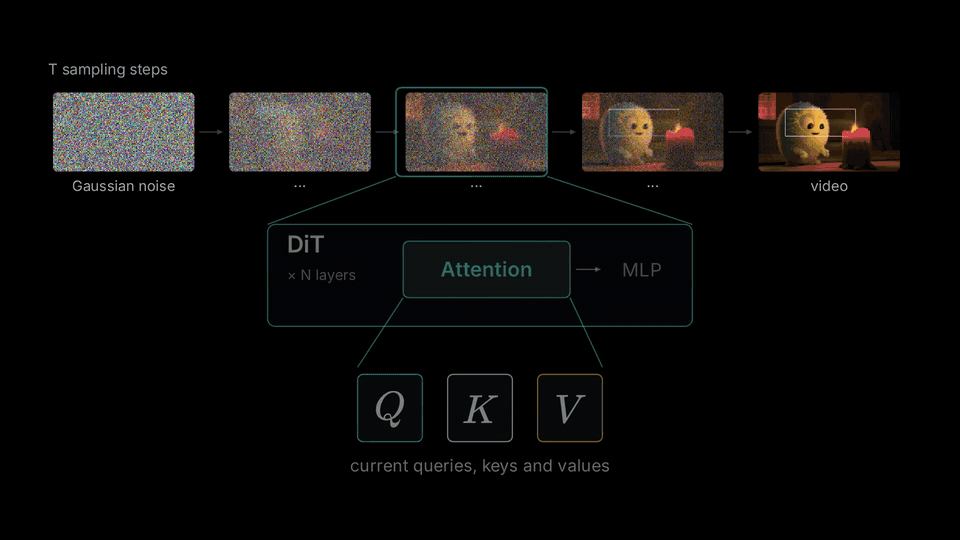

# EchoSparse

EchoSparse is block-sparse self-attention for video diffusion transformers. The softmax statistics of each
denoising step echo into the next one: they set its softmax offset, pick the blocks it computes and decide how
the skipped blocks are compensated. It needs no training and plugs into diffusers pipelines. It runs on NVIDIA
Blackwell GPUs: B200 (SM100) and RTX 5090 (SM120).

[中文说明](README_zh.md)



## How it works



*One attention layer on a toy example: the carried-over LSE, block selection, clustered representatives, the
single normalization and the fused B200 kernel, followed by measured B200 and RTX 5090 results.*

Between two denoising steps, the log-sum-exp (LSE) of each attention row changes very little. EchoSparse keeps the
previous step's LSE of every layer and CFG branch and uses it in three places, all inside one attention kernel:

1. **Fixed softmax offset.** The previous LSE takes the place of the running row maximum, so the kernel does no
   max reduction and no rescaling. Tiles whose row sums leave a safe range (about 0.5% of them) are recomputed
   with online softmax. For the same block lists this cuts kernel time by about 47%.
2. **Block probabilities from the same pass.** With that offset the exp values are already close to
   probabilities, so the kernel sums them per 64-token block while it computes the selected blocks. The next step
   takes the top blocks of every 128-row query tile from this map; there is no separate scoring pass.
3. **Compensation of skipped blocks.** Skipped blocks still take part in the same softmax: each through its mean
   key and value, weighted by its token count, and the most probable third of them through four representatives
   each, found by k-means in the query metric.

The first 10 denoising steps run dense with FlashAttention-4. The last of them sends every block through the
kernel to build the first probability map.

On the B200 the kernels are written in CuTe DSL with tcgen05 MMAs and tensor memory. The RTX 5090 has neither, so
its kernels are written in Triton with ordinary tensor-core dots. They compute the same quantities in the same
precision. Wan and HunyuanVideo use 64-token tiles. H3 uses two 32-token halves per block to reduce register
pressure, skips unused prefix query tiles, fuses representative means, and packs token metadata once per forward.
On RTX 5090, Wan and HunyuanVideo keep compact plans for the next step instead of retaining the full mass map;
CFG branches share block choices and keep their own LSE histories. The attention state stays on the GPU.

## Results

### B200

End-to-end video generation with 50 denoising steps. All methods keep the first 10 steps dense.
EchoSparse computes 10% of KV blocks; Sol-Attn uses its paper's exact threshold estimator with τ = 1.0;
PISA computes 12.5% with covariance-aware selection. PSNR is measured against FA4.

| Model | Blocks computed: ours / Sol-Attn / PISA | Speedup vs FA4: ours / Sol-Attn / PISA | PSNR: ours / Sol-Attn / PISA |
|---|---|---|---|
| Wan2.1-14B, 720p | 10% / 15% / 12.5% | 1.70× / 1.43× / 1.42× | 22.54 / 21.44 / 21.00 dB |
| Wan2.1-1.3B, 480p | 10% / 16% / 12.5% | 1.41× / 1.31× / 1.18× | 23.76 / 22.57 / 23.52 dB |
| HunyuanVideo-13B, 720p | 10% / 16% / 12.5% | 1.95× / 1.38× / 1.42× | 26.91 / 24.47 / 24.38 dB |
| MiniMax-H3 T2VA, 768p | 10% / 18% / 12.5% | 1.25× / 1.16× / 1.08× | 17.90 / 17.81 / 18.11 dB |

EchoSparse has the highest speedup on all four models. Its PSNR gains over Sol-Attn are 1.10 dB on Wan2.1-14B,
1.19 dB on Wan2.1-1.3B, and 2.44 dB on HunyuanVideo. On MiniMax-H3, the differences are +0.09 dB relative to
Sol-Attn and −0.21 dB relative to PISA; audio SNR is 4.9 dB for EchoSparse and 5.4 dB for Sol-Attn.

With Sol-Engine's diagonal threshold estimator, Sol-Attn computes 21–25% of KV blocks. In model order as above,
its PSNR is 22.34, 23.39, 25.47, and 18.70 dB, with speedups over FA4 of 1.24×, 1.17×, 1.27×, and 1.10×.
EchoSparse matches its quality on Wan, gains 1.44 dB on HunyuanVideo, and gives 0.8 dB lower PSNR on H3,
while running 1.12–1.54× faster.

### RTX 5090

All methods use the same block-wise CPU weight offloading.

| Transformer forward | EchoSparse density | FA4 | Sol-Attn | EchoSparse |
|---|---|---|---|---|
| MiniMax-H3, 768p, 124 frames | 0.24 | 18.19 s | 11.63 s | 11.58 s |
| HunyuanVideo, 720p, 129 frames | 0.10 | 63.60 s | 27.00 s | 24.13 s |
| Wan2.1-14B, 720p, 81 frames, conditional branch | 0.10 | 61.91 s | 46.08 s | 37.26 s |

MiniMax-H3 at density 0.24 achieves **18.99 dB PSNR**.

## Installation

Requirements: a B200 (SM100) or RTX 5090 (SM120) GPU, CUDA 12.8 or newer, Python 3.10 or newer.

```bash
git clone --branch main_sst_preview https://github.com/W2GenAI-Lab/EchoSparse-Attn.git
cd EchoSparse-Attn
pip install torch==2.11.0 --index-url https://download.pytorch.org/whl/cu128
pip install -e ".[examples]"
```

Dependencies are pinned in `pyproject.toml`. On RTX 5090, EchoSparse applies the SM120 compatibility fix from
[flash-attention PR #2484](https://github.com/Dao-AILab/flash-attention/pull/2484) to FlashAttention-4.
MiniMax-H3 uses diffusers commit `abc5e9bf` and transformers 5.8.1.

For MiniMax-H3, keep its diffusers source alongside this repository:

```bash
git clone https://github.com/huggingface/diffusers.git ../diffusers-h3
git -C ../diffusers-h3 checkout abc5e9bf71fd38f53cd471bc3acaa84bc5ecbfdc
pip install transformers==5.8.1
export PYTHONPATH="$(pwd)/../diffusers-h3/src:${PYTHONPATH}"
```

## Usage

### Quick start

On a B200, with every weight on the GPU:

```python
import torch
from diffusers import AutoencoderKLWan, UniPCMultistepScheduler, WanPipeline
import echosparse

model = "Wan-AI/Wan2.1-T2V-14B-Diffusers"
vae = AutoencoderKLWan.from_pretrained(model, subfolder="vae", torch_dtype=torch.float32)
pipe = WanPipeline.from_pretrained(model, vae=vae, torch_dtype=torch.bfloat16)
pipe.scheduler = UniPCMultistepScheduler.from_config(pipe.scheduler.config, flow_shift=5.0)
pipe.to("cuda")

echosparse.enable(pipe)      # after the scheduler is set: the attention follows its steps
video = pipe(prompt="A cat surfing at sunset", height=720, width=1280, num_frames=81,
             guidance_scale=5.0, num_inference_steps=50).frames[0]
```

`enable` recognizes the model and applies its preset. Keyword arguments override the preset values `density`,
`dense_steps`, `dense_layers` and `refine_iters`. Complete scripts for the three models are in `examples/`; they
support CPU weight offloading for the 32 GB RTX 5090.

### On an RTX 5090

Wan2.1-1.3B at 480p fits on the 32 GB GPU as it is:

```bash
python examples/wan.py --model Wan-AI/Wan2.1-T2V-1.3B-Diffusers --prompt "A cat surfing at sunset"
```

For the larger models, `--offload` keeps weights on the CPU and copies each group to the GPU as it runs:

```bash
python examples/wan.py --prompt "A cat surfing at sunset" --offload
python examples/hunyuan_video.py --prompt "A cat surfing at sunset" --offload
python examples/minimax_h3.py --model /path/to/MiniMax-H3 --prompt "A cat surfing at sunset" \
    --preset minimax_h3_rtx5090 --offload
```

Offload groups contain one block for Wan, 16 for HunyuanVideo, and eight by default for H3.
For the H3 forward times above, use `--group-size 12 --pin`.

Compact persistent attention state occupies about 1.89 GB for Wan2.1-14B (both CFG branches) and 1.37 GB for
HunyuanVideo at the resolutions above, plus one shared work buffer. H3 retains about 6.4 GB. This state stays
on the GPU throughout inference.

To insist on one GPU type, pass `gpu="b200"` or `gpu="rtx5090"`; a call on a different GPU then raises an error.

### Presets

| Model | Density | Dense steps | Dense layers | Notes |
|---|---|---|---|---|
| Wan2.1 | 0.10 | 10 | 0 | video tokens in 3D Morton order |
| HunyuanVideo | 0.10 | 10 | none | text tokens are computed exactly by every tile; text query rows use FA4 |
| MiniMax-H3 | 0.10 | 10 | 0 | the packed prefix is computed exactly by every tile; prefix query rows use FA4 |

The `minimax_h3_rtx5090` preset uses density 0.24, the setting of the RTX 5090 measurements above:

```python
echosparse.enable(pipe, preset="minimax_h3_rtx5090")      # density 0.24, 10 dense steps, layer 0 dense
```

### Other models

`echosparse.EchoSparseAttention` can be called directly:

```python
attn = echosparse.EchoSparseAttention(density=0.10, dense_steps=10, dense_layers=(0,))
attn.reset()                                           # before each video
out = attn(q, k, v, step=step, branch=branch, layer=layer)
```

`q`, `k`, `v` are `[1, L, heads, 128]` bf16 tensors of one self-attention call (batch size 1, queries and keys of
the same length; sequences shorter than 4096 tokens run dense). `branch` counts the transformer forwards inside a
denoising step (0 for the conditional pass, 1 for the unconditional one); later branches reuse the block selection
of branch 0. Tokens that every query should attend to exactly (text, conditioning) go at the end of the sequence,
with `sink` set to the index of their first 64-token block. If the caller recomputes some trailing query rows
itself (as the MiniMax-H3 integration does for the prefix), `rows=n` tells the attention that only the first `n`
output rows are used; the RTX 5090 kernels then skip the query tiles past them. `enable` patches diffusers'
attention dispatch of the model, so use one pipeline per process.

## License

Apache License 2.0. See [NOTICE](NOTICE) for third-party attributions.

## Core contributors

Tian Ye and Shitong Shao.
