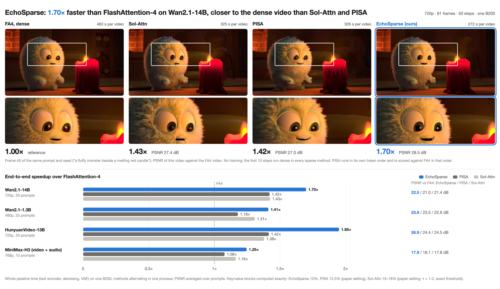
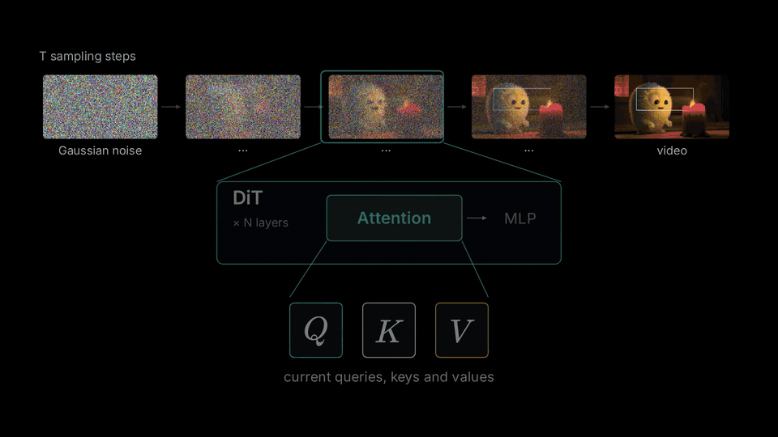

# EchoSparse

EchoSparse 是面向视频扩散模型的块稀疏自注意力。每个去噪步的 softmax 统计量会在下一步被再次利用（名字里的
Echo 即指这一点）：用来设定下一步的 softmax 偏移量、选择要计算的块，并决定跳过的块如何补偿。不需要训练，可以
直接接入 diffusers 流水线。可在 NVIDIA Blackwell GPU 上运行：B200（SM100）和 RTX 5090（SM120）。

[English](README.md)



## 原理



*用一个玩具例子演示一层注意力：沿用上一步的 LSE、选块、按聚类得到的代表、统一的归一化、B200 上的融合 kernel，以及 B200 的实测结果。*

相邻两个去噪步之间，每一行注意力的 log-sum-exp（LSE，softmax 分母的对数）变化很小。EchoSparse 为每一层、每个
CFG 分支保存上一步的 LSE，在同一个注意力 kernel 里用到三处：

1. **固定的 softmax 偏移量。** 用上一步的 LSE 代替逐行的运行最大值，kernel 不再求最大值，也不再重新缩放。行和超出
   安全范围的 tile（约 0.5%）改用在线 softmax 重算。在相同的块列表下，kernel 耗时减少约 47%。
2. **同一遍计算顺带得到块概率。** 有了这个偏移量，kernel 算出的指数值已经接近概率，计算选中块时顺带按 64 token
   的块累加，就得到块概率图。下一步直接按这张图给每个 128 行的 query tile 选块，不需要单独的打分计算。
3. **落选块的补偿。** 落选的块仍然进入同一个 softmax：每个块用它的平均 key 和平均 value 代表，权重是块内 token 数；
   块概率最高的三分之一落选块各用 4 个代表，由按 query 度量的 k-means 聚类得到。

前 10 个去噪步用 FlashAttention-4 稠密计算。其中最后一步让所有块都经过本 kernel，生成第一张块概率图。

在 B200 上，kernel 用 CuTe DSL 编写，使用 tcgen05 MMA 和 tensor memory。RTX 5090 没有这两者，所以它的 kernel 用
Triton 编写，使用普通的 tensor core 点积。两者计算的量和精度相同。为了放进 32 GB 显存，RTX 5090 在去噪步之间每层只保留
各 CFG 分支的 LSE 和下一步的选块（存成位图），块概率图是各层共用的临时空间。

## 结果

### B200

完整视频生成使用 50 个去噪步，各方法的前 10 步均采用稠密注意力。EchoSparse 精确计算 10% 的 KV 块；
Sol-Attn 使用论文中的完整阈值估计，τ = 1.0；PISA 按协方差选择 12.5% 的块。PSNR 以 FA4 为参考。

| 模型 | 精确计算的块：本方法 / Sol-Attn / PISA | 相对 FA4 加速：本方法 / Sol-Attn / PISA | PSNR：本方法 / Sol-Attn / PISA |
|---|---|---|---|
| Wan2.1-14B，720p | 10% / 15% / 12.5% | 1.70× / 1.43× / 1.42× | 22.54 / 21.44 / 21.00 dB |
| Wan2.1-1.3B，480p | 10% / 16% / 12.5% | 1.41× / 1.31× / 1.18× | 23.76 / 22.57 / 23.52 dB |
| HunyuanVideo-13B，720p | 10% / 16% / 12.5% | 1.95× / 1.38× / 1.42× | 26.91 / 24.47 / 24.38 dB |
| MiniMax-H3 T2VA，768p | 10% / 18% / 12.5% | 1.25× / 1.16× / 1.08× | 17.90 / 17.81 / 18.11 dB |

EchoSparse 在四个模型上均取得最高加速比。相对 Sol-Attn，PSNR 在 Wan2.1-14B 上高 1.10 dB，
在 Wan2.1-1.3B 上高 1.19 dB，在 HunyuanVideo 上高 2.44 dB。MiniMax-H3 相对 Sol-Attn 和 PISA 的差异分别为
+0.09 dB 和 −0.21 dB；音频 SNR 分别为 EchoSparse 4.9 dB、Sol-Attn 5.4 dB。

Sol-Engine 的对角阈值估计会计算 21–25% 的 KV 块。按上表模型顺序，Sol-Attn 的 PSNR 为 22.34、23.39、25.47、
18.70 dB，相对 FA4 的加速比分别为 1.24×、1.17×、1.27×、1.10×。EchoSparse 在 Wan 上画质相当，在 HunyuanVideo 上
高 1.44 dB，在 H3 上低 0.8 dB，速度快 1.12–1.54 倍。

### RTX 5090

用本包和 `examples/` 里的脚本做完整生成：50 个去噪步，每个模型 1 个提示词，种子与 B200 评测相同，EchoSparse 和
FA4 稠密各跑一遍。Wan2.1-14B、HunyuanVideo、MiniMax-H3 的权重放在 CPU 内存里，按组拷到 GPU（`--offload`）；
Wan2.1-1.3B 直接放在 GPU 上。单次前向取同一次运行中稠密步和稀疏步各自的中位数。

| 模型 | 单次前向：FA4 / EchoSparse | 整段视频：FA4 / EchoSparse | PSNR（B200 同一提示词） |
|---|---|---|---|
| Wan2.1-14B，720p | 58.5 s / 36.4 s（1.61×） | — | 22.50（21.40）dB |
| Wan2.1-1.3B，480p | 1.63 s / 0.86 s（1.90×） | 169 s / 119 s（1.42×） | 22.85（22.67）dB |
| HunyuanVideo，720p | 63.5 s / 21.0 s（3.02×） | 3273 s / 1648 s（1.99×） | 31.18（26.88）dB |
| MiniMax-H3，768p，密度 0.24 | 18.6 s / 11.7 s（1.59×） | 1475 s / 1235 s（1.19×） | 19.58（17.11）dB |

Wan2.1-14B 的 FA4 运行与另一张 GPU 上的运行共用主机内存带宽，所以不列整段时间。RTX 5090 上没有用本包测 Sol-Attn。

## 安装

需要 B200（SM100）或 RTX 5090（SM120）GPU、CUDA 12.8 或更新版本、Python 3.10 或更新版本。

```bash
git clone https://github.com/W2GenAI-Lab/EchoSparse-Attn.git
cd EchoSparse-Attn
pip install torch==2.11.0 --index-url https://download.pytorch.org/whl/cu128
pip install -e ".[examples]"
```

依赖版本固定在 `pyproject.toml` 中。RTX 5090 上，EchoSparse 为 FlashAttention-4 应用
[flash-attention PR #2484](https://github.com/Dao-AILab/flash-attention/pull/2484) 的 SM120 兼容修复。
MiniMax-H3 使用 diffusers 提交 `abc5e9bf` 和 transformers 5.8.1。

MiniMax-H3 的 diffusers 源码放在本仓库旁边，通过源码路径加载：

```bash
git clone https://github.com/huggingface/diffusers.git ../diffusers-h3
git -C ../diffusers-h3 checkout abc5e9bf71fd38f53cd471bc3acaa84bc5ecbfdc
pip install transformers==5.8.1
export PYTHONPATH="$(pwd)/../diffusers-h3/src:${PYTHONPATH}"
```

## 用法

### 快速开始

在 B200 上，所有权重都放在 GPU 上：

```python
import torch
from diffusers import AutoencoderKLWan, UniPCMultistepScheduler, WanPipeline
import echosparse

model = "Wan-AI/Wan2.1-T2V-14B-Diffusers"
vae = AutoencoderKLWan.from_pretrained(model, subfolder="vae", torch_dtype=torch.float32)
pipe = WanPipeline.from_pretrained(model, vae=vae, torch_dtype=torch.bfloat16)
pipe.scheduler = UniPCMultistepScheduler.from_config(pipe.scheduler.config, flow_shift=5.0)
pipe.to("cuda")

echosparse.enable(pipe)      # 在设置好调度器之后调用：注意力按调度器的步数推进
video = pipe(prompt="A cat surfing at sunset", height=720, width=1280, num_frames=81,
             guidance_scale=5.0, num_inference_steps=50).frames[0]
```

`enable` 会识别模型并使用对应的预设。关键字参数可以覆盖预设中的 `density`、`dense_steps`、`dense_layers` 和
`refine_iters`。三个模型的完整脚本在 `examples/` 目录，支持通过 CPU 权重卸载在 32 GB RTX 5090 上运行。

### 在 RTX 5090 上

480p 的 Wan2.1-1.3B 可以直接放进 32 GB 显存：

```bash
python examples/wan.py --model Wan-AI/Wan2.1-T2V-1.3B-Diffusers --prompt "A cat surfing at sunset"
```

较大的模型通过 `--offload` 把权重保存在 CPU 上，每组执行时再拷入 GPU：

```bash
python examples/wan.py --prompt "A cat surfing at sunset" --offload
python examples/hunyuan_video.py --prompt "A cat surfing at sunset" --offload
python examples/minimax_h3.py --model /path/to/MiniMax-H3 --prompt "A cat surfing at sunset" \
    --preset minimax_h3_rtx5090 --offload
```

Wan 的权重卸载每组包含 1 个 block，HunyuanVideo 为 16 个，H3 默认为 8 个；H3 用 `--group-size 12 --pin` 的单次
前向耗时相同。`examples/minimax_h3.py` 会设置 `PYTORCH_CUDA_ALLOC_CONF=expandable_segments:True`，减少 32 GB GPU 上
CUDA 显存的碎片。

上述分辨率下，去噪步之间保留的注意力状态：Wan2.1-14B 两个 CFG 分支共约 1.89 GB，HunyuanVideo 约 1.37 GB，
MiniMax-H3 约 0.63 GB，另需一份共享工作缓冲区。这些状态在推理期间始终保存在 GPU 上。

若要指定 GPU 类型，传入 `gpu="b200"` 或 `gpu="rtx5090"`；在不符的 GPU 上调用时会报错。

### 预设

| 模型 | 密度 | 稠密步数 | 稠密层 | 说明 |
|---|---|---|---|---|
| Wan2.1 | 0.10 | 10 | 0 | 视频 token 按三维 Morton 顺序重排 |
| HunyuanVideo | 0.10 | 10 | 无 | 文本 token 对每个 tile 都精确计算；文本 query 行用 FA4 |
| MiniMax-H3 | 0.10 | 10 | 0 | 打包序列的前缀对每个 tile 都精确计算；前缀 query 行用 FA4 |

预设 `minimax_h3_rtx5090` 使用密度 0.24，即上述 RTX 5090 测量采用的设置：

```python
echosparse.enable(pipe, preset="minimax_h3_rtx5090")      # 密度 0.24，10 个稠密步，第 0 层稠密
```

### 其他模型

可以直接调用 `echosparse.EchoSparseAttention`：

```python
attn = echosparse.EchoSparseAttention(density=0.10, dense_steps=10, dense_layers=(0,))
attn.reset()                                           # 每段视频开始前调用
out = attn(q, k, v, step=step, branch=branch, layer=layer)
```

`q`、`k`、`v` 是一次自注意力调用的 `[1, L, heads, 128]` bf16 张量（批大小为 1，query 与 key 长度相同；短于 4096
token 的序列走稠密计算）。`branch` 是一个去噪步内 transformer 前向的序号（条件分支为 0，无条件分支为 1），后面的
分支复用分支 0 的选块结果。需要被所有 query 精确计算的 token（文本、条件输入）放在序列末尾，并把 `sink` 设为它们
所在的第一个 64 token 块的序号。如果调用方自己重算末尾的一些 query 行（MiniMax-H3 的集成对前缀就是这样做的），
`rows=n` 告诉注意力只用到前 `n` 行输出；RTX 5090 的 kernel 会跳过之后的 query tile。`enable` 会替换 diffusers 中
该模型的注意力分派函数，所以一个进程里只用一条流水线。

## 许可证

Apache License 2.0。第三方来源见 [NOTICE](NOTICE)。

## 核心贡献者

Tian Ye and Shitong Shao.
